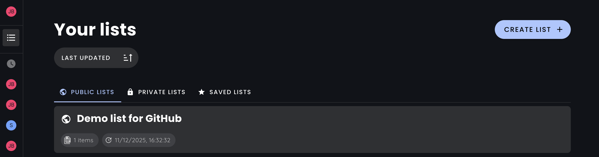
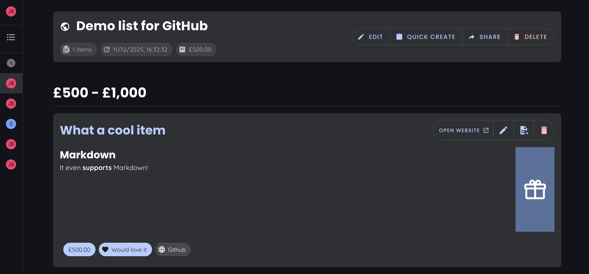

# Readyto.gift




This is a simple Wishlist app, to keep track of things you'd like. If anyone buys you anything from it, they can mark it down as such, so you don't get duplicates.

## Why did I make this?

- Amazon wishlists are very limited
- A google doc or notion page lacks a few features, like the author not knowing what has been purchased
- [wishthis](https://github.com/wishthis/wishthis) is a good alternative for this, and this was inspired by it. However, I liked a few things to be done in a different way.

## Stack

- Frontend: Astro + Vue + NanoStores + Vuetify
  - Familiar, nicely reactive and wanted to try out something like Vuetify - also means I didn't need to design this beforehand.
  - This isn't the most performant app. I could've gone with a more efficient setup, maybe making use of SSR, but this is a simple app that I'll only use a few times a year.
- Backend: Astro + Cloudflare D1, R2, KV, and Better Auth

## Features

- Multiple users
- Multiple lists
- Items can be marked as purchased
- Author can choose to see what has been purchased or not
- Multiple currency support, configurable per list

## Setup

### Requirements

The project requires Node.js 22 and pnpm.

Install the dependencies with:

```sh
pnpm install
```

### Environment

Runtime configuration is provided through environment variables. The main groups are:

- `BETTER_AUTH_SECRET` and `BETTER_AUTH_URL` for authentication
- `CLOUDFLARE_*` variables for D1 and R2
- `PLUNK_*` variables for transactional email
- `POLAR_*` variables and `ENABLE_BILLING` for billing
- `FREE_TIER_*` variables for usage limits
- `UMAMI_*` variables for optional analytics

For local development, create a `.env` file with the required values. This repository also includes an `op` wrapper for loading secrets from 1Password:

```sh
pnpm op dev
```

The `op` command expects the relevant secret references in `1password.env`.

### Database and deployment

Generate a Drizzle migration after schema changes with:

```sh
pnpm db:generate
```

Apply D1 migrations remotely with:

```sh
pnpm db:migrate:prod
```

Build and run the production preview with:

```sh
pnpm build
pnpm preview
```

The application is designed for deployment on Cloudflare using the Astro Cloudflare adapter.

### Migrating legacy data

The one-time migration script copies users, lists, items, fulfillments, autofill records, and images from the legacy Appwrite instance into the current D1/R2 schema. It preserves legacy IDs and timestamps and is a dry run by default:

```sh
pnpm op db:migrate:appwrite
pnpm op db:migrate:appwrite -- --apply
```

The migration requires the legacy `APPWRITE_*` credentials and the Cloudflare credentials from `1password.env`. Legacy password hashes cannot be transferred, so migrated users must set new passwords through Better Auth.

### Development

```sh
pnpm dev
```

Run the formatter and linter with:

```sh
pnpm exec biome check .
```

## Billing

Billing is controlled by `ENABLE_BILLING`. When enabled, checkout and subscription management use Polar through Better Auth.

You can change the limits using the following:

- `FREE_TIER_PUBLIC_LIST_LIMIT`
  How many public lists a user can have. A public list is one that anyone can view, and the author can choose to show what has been purchased or not.
  Set to `-1` for unlimited.
- `FREE_TIER_PRIVATE_LIST_LIMIT`
  How many private lists a user can have. A private list is one that only the author can view.
  Set to `-1` for unlimited.
- `FREE_TIER_ITEMS_PER_LIST`
  How many items can be in a list.
  Set to `-1` for unlimited.
- `FREE_TIER_ENABLE_AUTOFILL`
  Whether to allow autofill. Set to `true` to allow it, `false` to disable it. Autofill tries to fill in item details such as the name and image from a URL.

# License

This project is licensed under the PolyForm Noncommercial License 1.0.0.

You are free to use, modify, and distribute this software for noncommercial purposes. Any commercial use of this software is strictly prohibited. See the [LICENSE](./LICENSE) file for more details.
