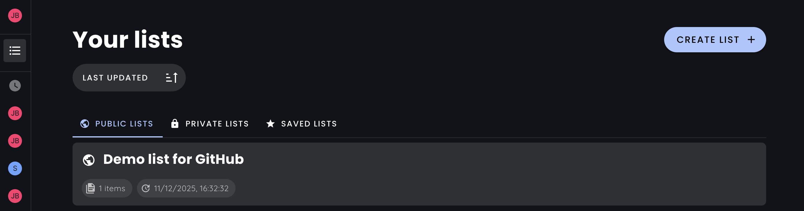
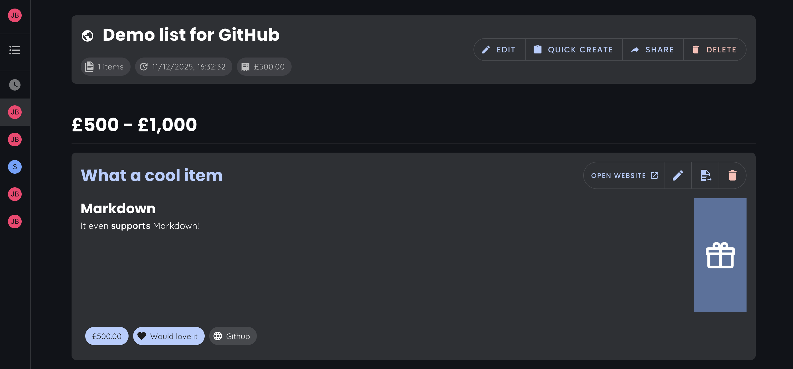

# Readyto.gift




This is a simple Wishlist app, to keep track of things you'd like. If anyone buys you anything from it, they can mark it down as such, so you don't get duplicates.

## Why did I make this?

- Amazon wishlists are very limited
- A google doc or notion page lacks a few features, like the author not knowing what has been purchased
- [wishthis](https://github.com/wishthis/wishthis) is a good alternative for this, and this was inspired by it. However, I liked a few things to be done in a different way.

## Stack

- Frontend: Astro + Vue + NanoStores + Vuetify
  - Familiar, nicely reactive and wanted to try out something like Vuetify - also means I didn't need to design this beforehand.
  - This isn't the most performant app. I could've gone with a more efficient setup, maybe making use of SSR, but this is a simple app that I'll only use a few times a year.
- Backend: Astro + Cloudflare D1, R2, KV, and Better Auth

## Features

- Multiple users
- Multiple lists
- Items can be marked as purchased
- Author can choose to see what has been purchased or not
- Multiple currency support, configurable per list

## Setup

### Requirements

The project requires Node.js 26 and pnpm 12.

Install the dependencies with:

```sh
pnpm install
```

### Environment

Runtime configuration is provided through environment variables. Copy the example file to get started:

```sh
cp .env.example .env
```

The minimum useful standalone Node configuration is:

| Variable              | Required  | Description                                                                        |
| --------------------- | --------- | ---------------------------------------------------------------------------------- |
| `BETTER_AUTH_SECRET`  | Yes       | Secret used to sign authentication data. Generate one with `openssl rand -hex 32`. |
| `PLUNK_BASE_URL`      | For email | Base URL for the Plunk-compatible email API.                                       |
| `PLUNK_SECRET_KEY`    | For email | API key used to send transactional email.                                          |
| `PLUNK_SENDING_EMAIL` | For email | Verified sender address for transactional email.                                   |

Email variables are only needed when a feature sends email, but production deployments should normally configure all three. `DATA_DIR` is optional; it defaults to `data` and controls where the Node deployment stores its SQLite database, uploaded images, and cached sessions.

#### Application settings

| Variable                | Default                | Description                                                                                            |
| ----------------------- | ---------------------- | ------------------------------------------------------------------------------------------------------ |
| `DOMAIN`                | `readyto.gift`         | Public hostname. Used for built links and Better Auth's runtime host allowlist.                        |
| `ALLOWED_DOMAINS`       | Unset                  | Optional comma-separated hostnames trusted by Astro for forwarded-host validation. Requires a rebuild. |
| `TRUSTED_PROXY_HEADERS` | `false`                | Trust `X-Forwarded-Host` and `X-Forwarded-Proto` in Better Auth. Only enable behind a trusted proxy.   |
| `BUILD_COMMIT`          | Detected automatically | Commit identifier shown by the application.                                                            |
| `CLOUDFLARE`            | `false`                | Selects the Cloudflare adapter when set to `true`; set to `false` for Node/Docker builds.              |
| `DATA_DIR`              | `data`                 | Persistent data directory for standalone Node deployments.                                             |

#### Billing and free-tier limits

`ENABLE_BILLING` is set to false by default. Please note that commerical use is not permitted under under the PolyForm Noncommercial License 1.0.0 for this project.

You can make use of the `FREE_TIER` limits to add limitations for users.

| Variable                     | Description                                              |
| ---------------------------- | -------------------------------------------------------- |
| FREE_TIER_PUBLIC_LIST_LIMIT  | Max public lists for users, default is `-1 (unlimited)`  |
| FREE_TIER_PRIVATE_LIST_LIMIT | Max private lists for users, default is `-1 (unlimited)` |
| FREE_TIER_ITEMS_PER_LIST     | Max items per list, default is `-1 (unlimited)`          |
| FREE_TIER_ENABLE_AUTOFILL    | Enable autofill for free-tier users, default is `false`  |

`AUTOFILL_FREE_ALLOWANCE` is reliant on billing being enabled.


#### Optional integrations

| Variable                        | Description                                                                 |
| ------------------------------- | --------------------------------------------------------------------------- |
| `CLOUDFLARE_R2_ENDPOINT`        | Public base URL for images stored in Cloudflare R2. (Cloudflare only)       |
| `UMAMI_URL`                     | Umami script URL. Configure with `UMAMI_ID` and optionally `UMAMI_DOMAINS`. |
| `UMAMI_ID`                      | Umami website identifier.                                                   |
| `UMAMI_DOMAINS`                 | Comma-separated domains on which analytics should run.                      |
| `SENTRY_DSN`                    | Runtime Sentry DSN.                                                         |
| `SENTRY_AUTH_TOKEN`             | Build-time Sentry token for uploading source maps.                          |
| `AUTOFILL_USE_LOCAL_FETCH`      | Uses the local fetch implementation for autofill when `true`.               |
| `AUTOFILL_HTTP_PROXIES`         | Optional proxy list for autofill requests.                                  |
| `AUTOFILL_PROXY_USERNAME`       | Optional proxy username template.                                           |
| `AUTOFILL_PROXY_PASSWORD`       | Optional proxy password.                                                    |
| `AUTOFILL_PROXY_COUNTRY_PREFIX` | Optional country suffix used by the proxy provider.                         |
| `AUTOFILL_PROXY_HOST`           | Optional proxy host.                                                        |
| `AUTOFILL_PROXY_ATTEMPTS`       | Number of autofill proxy attempts; defaults to `3`.                         |

Cloudflare deployments use the bindings in `wrangler.jsonc` for D1, KV, and R2. The `CLOUDFLARE_*` account, database, bucket, and API token variables below are used by the migration and maintenance scripts rather than by the deployed Worker itself.

For local development, create a `.env` file with the values you need. This repository also includes an `op` wrapper for loading secrets from 1Password:

```sh
pnpm op dev
```

The `op` command expects the relevant secret references in `1password.env`.

### Database and deployment

Node and Cloudflare use the same Drizzle migrations. Generate a migration after schema changes with:

```sh
pnpm db:generate
```

The database in `src/db.js` applies pending migrations automatically. Node runs them when opening SQLite. Cloudflare D1 runs them before the first query.

Build and run the Cloudflare production preview with:

```sh
CLOUDFLARE=true pnpm build
CLOUDFLARE=true pnpm preview
```

For standalone Node.js, build with `CLOUDFLARE=false` and start the server:

```sh
CLOUDFLARE=false pnpm build
node --env-file=.env dist/server/entry.mjs
```

Set `BETTER_AUTH_SECRET` and the `PLUNK_*` settings in `.env` for authentication and transactional email. Start Node from the project directory so Drizzle can read `migrations/`. Node applies the database migrations automatically and stores lists, uploaded images, and cached sessions in `data/readytogift.sqlite`. Set `DATA_DIR` to use a different directory and mount that directory on a persistent volume when running in a container.

#### Docker

The included Docker image uses the Node adapter and a distroless Node.js runtime. Build and run it with:

```sh
docker compose build
docker compose up -d
```

The compose file loads `.env`, maps port `8000` to the application’s port `4321`, and mounts `./data` so the SQLite database and uploaded files persist across container updates. Check the service status with:

```sh
docker compose ps
docker compose logs -f readytogift
```

The image is built with `CLOUDFLARE=false`. Use the Cloudflare commands above for a Cloudflare build instead.

### Migrating legacy data

The one-time migration script copies users, lists, items, fulfillments, autofill records, and images from the legacy Appwrite instance into the current D1/R2 schema. It preserves legacy IDs and timestamps and is a dry run by default:

```sh
pnpm op db:migrate:appwrite
pnpm op db:migrate:appwrite -- --apply
```

The migration requires the legacy `APPWRITE_*` credentials and the Cloudflare credentials from `1password.env`. Legacy password hashes cannot be transferred, so migrated users must set new passwords through Better Auth.

The migration script uses these variables:

| Variable                          | Required | Description                                                          |
| --------------------------------- | -------- | -------------------------------------------------------------------- |
| `CLOUDFLARE_ACCOUNT_ID`           | Yes      | Cloudflare account containing the D1 database and R2 bucket.         |
| `CLOUDFLARE_DATABASE_ID`          | Yes      | Destination D1 database ID.                                          |
| `CLOUDFLARE_D1_TOKEN`             | Yes      | API token with permission to query the destination D1 database.      |
| `CLOUDFLARE_R2_TOKEN`             | Yes      | API token with permission to list and delete destination R2 objects. |
| `CLOUDFLARE_R2_BUCKET`            | No       | Destination R2 bucket; defaults to `readytogift`.                    |
| `APPWRITE_ENDPOINT`               | Yes      | Legacy Appwrite endpoint.                                            |
| `APPWRITE_PROJECT`                | Yes      | Legacy Appwrite project ID.                                          |
| `APPWRITE_KEY`                    | Yes      | Legacy Appwrite API key.                                             |
| `APPWRITE_DB`                     | No       | Legacy Appwrite database ID; defaults to `wishlist`.                 |
| `APPWRITE_IMAGE_BUCKET`           | No       | Legacy Appwrite image bucket ID; defaults to `default`.              |
| `APPWRITE_LIST_COLLECTION`        | No       | Legacy list collection ID.                                           |
| `APPWRITE_ITEM_COLLECTION`        | No       | Legacy item collection ID.                                           |
| `APPWRITE_FULFILLMENT_COLLECTION` | No       | Legacy fulfillment collection ID.                                    |

After migration, preview the password-reset notice recipients with:

```sh
pnpm op email:migration
```

Test the email with one recipient before sending to everyone:

```sh
pnpm op email:migration -- --email=you@example.com --send
```

To include the early-supporter lifetime Pro offer, provide a redemption code with
`--pro-code=CODE` (or set `MIGRATION_PRO_CODE`):

```sh
pnpm op email:migration -- --email=you@example.com --pro-code=CODE --send
```

Send the notice to all users only after verifying the preview:

```sh
pnpm op email:migration -- --send
```

The email links to `https://readyto.gift` by default. Set `MIGRATION_SITE_URL` to use a staging URL.

The migration email script additionally uses `BETTER_AUTH_URL` or `MIGRATION_SITE_URL` for links. Sending email requires `PLUNK_BASE_URL`, `PLUNK_SECRET_KEY`, and `PLUNK_SENDING_EMAIL`; generating the optional Pro discount codes also requires `POLAR_ACCESS_TOKEN` and `POLAR_PRO_PRODUCT_ID`.

### Development

```sh
pnpm dev
```

Run the formatter and linter with:

```sh
pnpm exec biome check .
```

## Billing

Billing is controlled by `ENABLE_BILLING`. When enabled, checkout and subscription management use Polar through Better Auth.

You can change the limits using the following:

- `FREE_TIER_PUBLIC_LIST_LIMIT`
  How many public lists a user can have. A public list is one that anyone can view, and the author can choose to show what has been purchased or not.
  Set to `-1` for unlimited.
- `FREE_TIER_PRIVATE_LIST_LIMIT`
  How many private lists a user can have. A private list is one that only the author can view.
  Set to `-1` for unlimited.
- `FREE_TIER_ITEMS_PER_LIST`
  How many items can be in a list.
  Set to `-1` for unlimited.
- `FREE_TIER_ENABLE_AUTOFILL`
  Whether to allow autofill. Set to `true` to allow it, `false` to disable it. Autofill tries to fill in item details such as the name and image from a URL.

# License

This project is licensed under the PolyForm Noncommercial License 1.0.0.

You are free to use, modify, and distribute this software for noncommercial purposes. Any commercial use of this software is strictly prohibited. See the [LICENSE](./LICENSE) file for more details.
